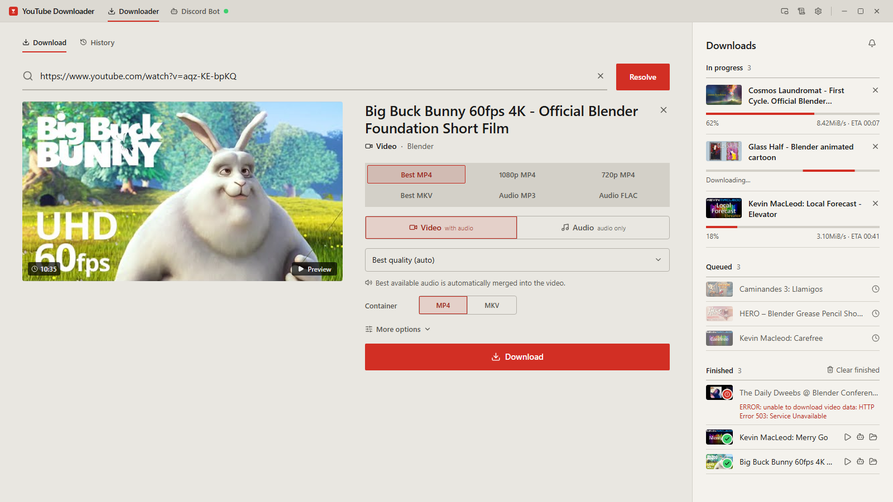
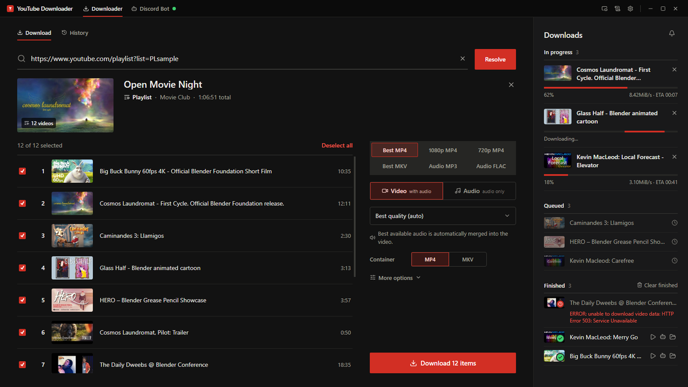
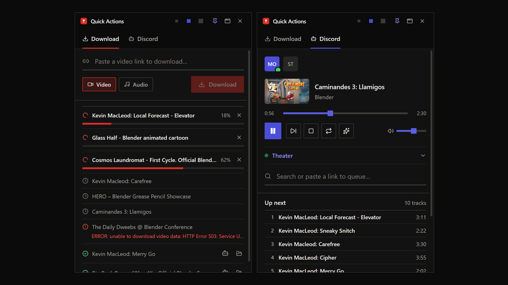
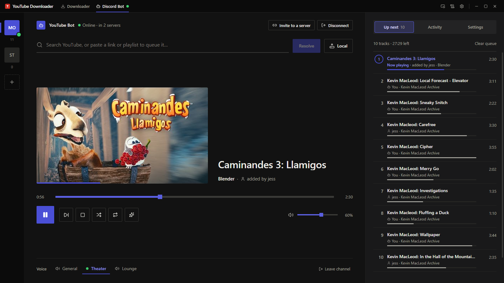
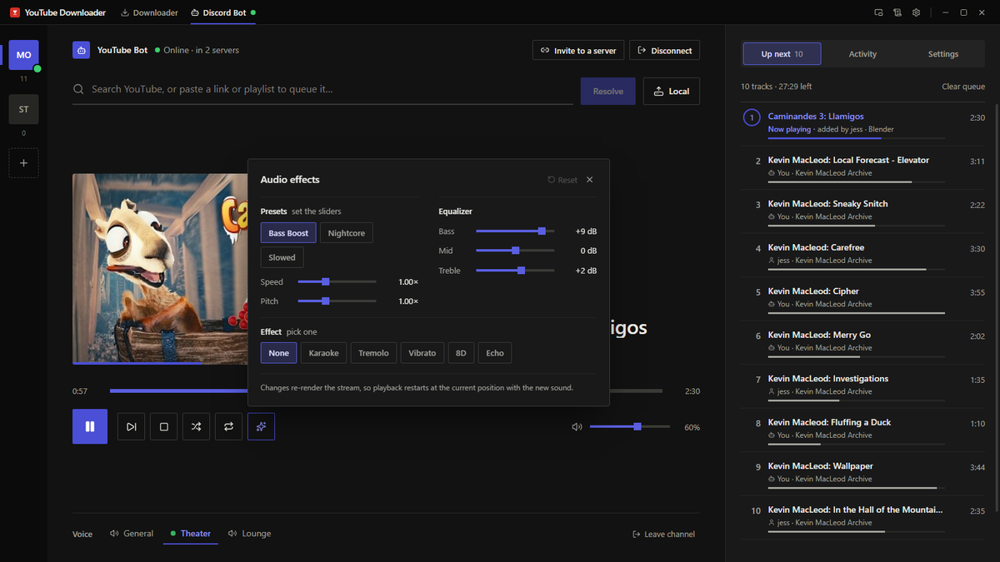
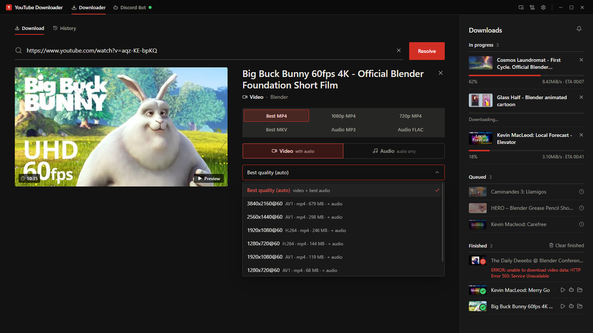
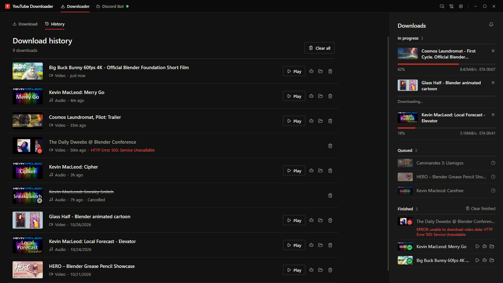
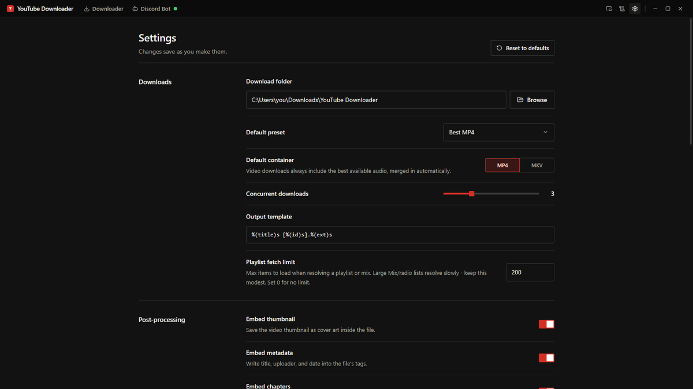
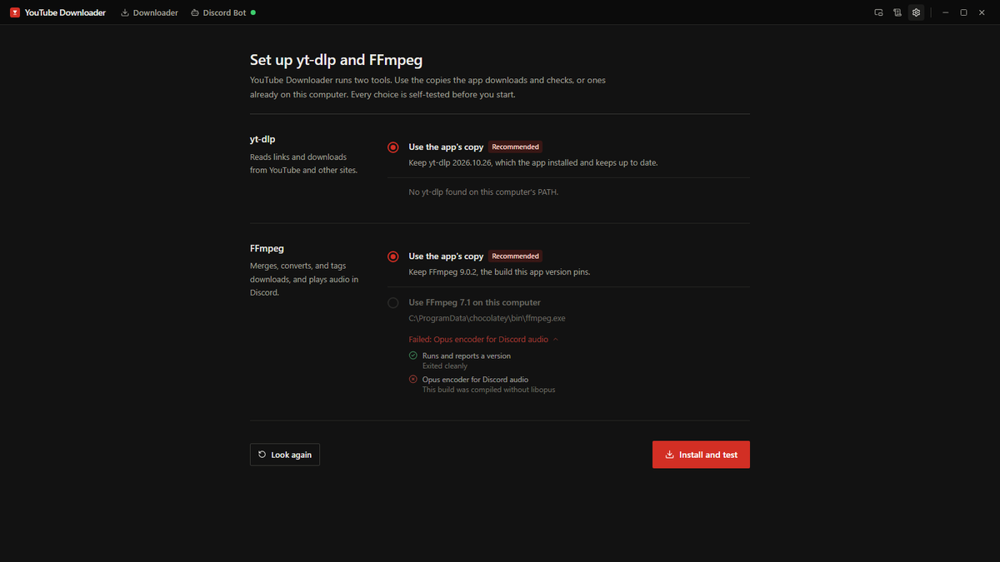
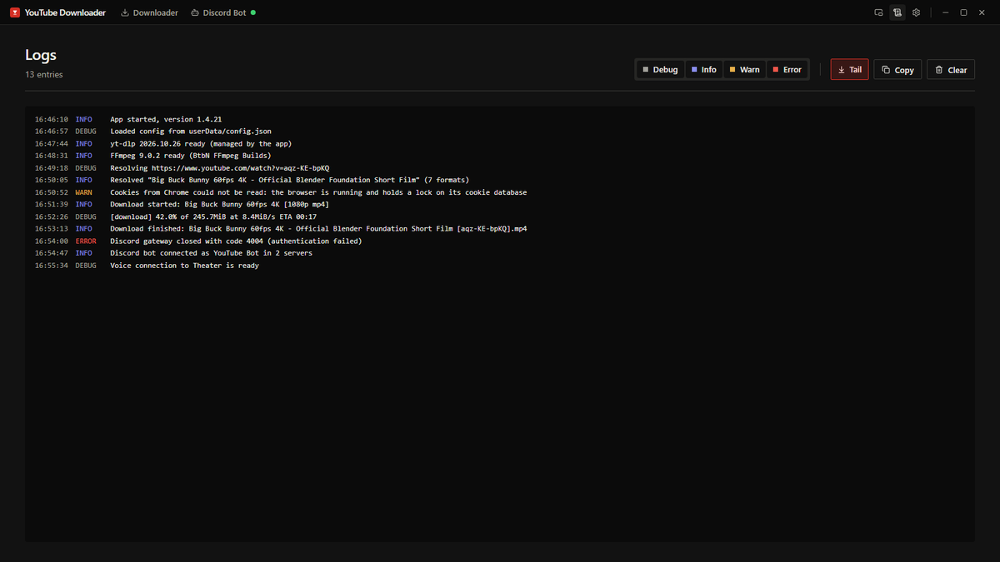

<div align="center">

<h1>
  <picture>
    <source media="(prefers-color-scheme: dark)" srcset=".github/assets/logo-dark.svg">
    
  </picture>
</h1>

**Paste a YouTube link, pick a preset, get the file. The same app runs your own Discord music bot.**

<a href="https://github.com/molexxxx/youtube-downloader/actions/workflows/ci.yml"></a>
<a href="https://github.com/molexxxx/youtube-downloader/releases"></a>
<a href="https://github.com/molexxxx/youtube-downloader/releases"></a>
<a href="LICENSE"></a>

**[Download for Windows, macOS, or Linux](#install)**

[Screenshots](#screenshots) · [Features](#features) · [Discord music bot](#discord-music-bot) · [Troubleshooting](#troubleshooting) · [Build from source](#build-from-source)

<br/>

<picture>
  <source media="(prefers-color-scheme: dark)" srcset=".github/assets/screenshots/hero-dark.png">
  
</picture>

</div>

## How it works

1. **Paste or search.** Drop in a YouTube link to a video, playlist, channel, or Mix, or type keywords to search YouTube from the same bar.
2. **Pick a preset.** Best MP4, 1080p MP4, 720p MP4, Best MKV, Audio MP3, or Audio FLAC. Power users can choose the exact resolution, frame rate, and codec instead.
3. **Download.** Files land in your Downloads folder with the thumbnail, metadata, and chapters embedded.

The app sets up and updates its own copies of [yt-dlp](https://github.com/yt-dlp/yt-dlp) and [FFmpeg](https://ffmpeg.org), so there is nothing else to install. It is free, needs no account or API key, and sends no telemetry.

## Install

Download the file for your system from the **[latest release](https://github.com/molexxxx/youtube-downloader/releases/latest)**:

| System      | File to download                                             | Requirements                                   |
| ----------- | ------------------------------------------------------------ | ---------------------------------------------- |
| **Windows** | `YouTube-Downloader-<version>-Windows-Setup.exe`             | Windows 10 or 11, 64-bit (x64)                 |
| **macOS**   | `YouTube-Downloader-<version>-macOS-Installer.dmg`           | Apple Silicon (M1 or later), macOS 13 or later |
| **Linux**   | `YouTube-Downloader-<version>-Linux-Installer.deb` or `.rpm` | 64-bit (x64)                                   |

The other files on the release page (`.yml` files and the macOS `Updater.zip`) are used by the built-in updater; you do not need them.

- **Windows SmartScreen:** the installer is not code-signed yet, so Windows may say "Windows protected your PC". Choose **More info**, then **Run anyway**. The macOS build is signed and notarized by Apple.
- **First launch:** a short setup screen offers the app's own verified copies of yt-dlp and FFmpeg (or copies already on your computer) and installs them with one click. Expect a download of about 220 MB on Windows, 190 MB on Linux, and 95 MB on macOS.
- **Intel Macs** are not supported: Discord's encrypted voice module cannot be built into a universal macOS app.
- **Updates:** the app updates itself from GitHub Releases, and keeps yt-dlp current on its own.

## Screenshots

<div align="center">

<table>
  <tr>
    <td align="center" width="50%">
      <a href=".github/assets/screenshots/playlist.png"></a>
      <br/><sub><b>Playlists:</b> pick exactly which items to download</sub>
    </td>
    <td align="center" width="50%">
      <a href=".github/assets/screenshots/quick-actions.png"></a>
      <br/><sub><b>Quick Actions:</b> an always-on-top mini window for both</sub>
    </td>
  </tr>
  <tr>
    <td align="center" width="50%">
      <a href=".github/assets/screenshots/discord.png"></a>
      <br/><sub><b>Discord bot:</b> now playing, the queue, and voice channels</sub>
    </td>
    <td align="center" width="50%">
      <a href=".github/assets/screenshots/effects.png"></a>
      <br/><sub><b>Audio effects:</b> speed, pitch, EQ, and one-tap presets</sub>
    </td>
  </tr>
</table>

</div>

<details>
<summary><b>More screenshots</b></summary>
<br/>

<table>
  <tr>
    <td align="center" width="50%">
      <a href=".github/assets/screenshots/quality.png"></a>
      <br/><sub><b>Exact quality:</b> resolution, frame rate, codec, and size</sub>
    </td>
    <td align="center" width="50%">
      <a href=".github/assets/screenshots/history.png"></a>
      <br/><sub><b>History:</b> replay, open the folder, or send to Discord</sub>
    </td>
  </tr>
  <tr>
    <td align="center" width="50%">
      <a href=".github/assets/screenshots/settings.png"></a>
      <br/><sub><b>Settings</b></sub>
    </td>
    <td align="center" width="50%">
      <a href=".github/assets/screenshots/setup.png"></a>
      <br/><sub><b>Setup:</b> the app's verified copies or your own</sub>
    </td>
  </tr>
  <tr>
    <td align="center" width="50%">
      <a href=".github/assets/screenshots/logs.png"></a>
      <br/><sub><b>Logs:</b> filter by level, follow, and copy</sub>
    </td>
    <td width="50%"></td>
  </tr>
</table>

</details>

<sub>Screenshots use mock data showing Creative Commons Attribution works: films by the Blender Foundation (Big Buck Bunny, Cosmos Laundromat, Caminandes 3, Glass Half, HERO, The Daily Dweebs) and music by Kevin MacLeod (incompetech.com).</sub>

## Features

### Downloading

- **Links or search:** videos, playlists, channels, and Mixes from a link, or search YouTube by keyword with no API key. A link that points at one video inside a playlist asks whether you want the video or the whole list.
- **Presets or exact formats:** six one-click presets, or a specific resolution, frame rate, and codec (H.264, VP9, AV1) up to 4K, always merged with the best audio.
- **Video or audio:** MP4 or MKV video; MP3, M4A, Opus, FLAC, or WAV audio at 96 to 320 kbps.
- **Playlist picker:** choose items one by one and load more past the fetch limit.
- **Post-processing:** embed the thumbnail, metadata, and chapters; download subtitles; cut sponsor, self-promotion, intro, outro, and other non-content segments with SponsorBlock; skip files you already have with a download archive.
- **Sign-in when needed:** import cookies from your browser for age-restricted, private, or members-only videos. Downloads retry with cookies when YouTube asks for sign-in.
- **Queue and history:** up to 8 downloads at once with live speed and ETA, desktop notifications, and a history you can replay or open in its folder.
- **Preview:** watch any result in the app before you download it.

### Runs itself

- **Guided setup and self-tests:** use the app's copies of yt-dlp and FFmpeg or ones already on your computer. Every copy is self-tested before use and after each update.
- **Verified yt-dlp updates:** checked once a day or on demand. A release installs only after it matches the checksums signed by the yt-dlp release key, and never while a download or playback is using yt-dlp.
- **Pinned FFmpeg:** each app version pins exact FFmpeg builds by size and SHA-256 (from BtbN, with Gyan.dev and Martin Riedl as fallbacks on Windows and Linux, and from Martin Riedl on macOS), so every install runs the tested build.
- **Quick Actions:** a compact always-on-top window, in three sizes, for downloads and bot control.
- **Stays out of the way:** close to the tray, launch at login on Windows, macOS, or Linux, and start minimized.
- **Themes:** System, Dark, or Light.
- **Private:** no account and no telemetry. The app only talks to YouTube, GitHub (for app and yt-dlp updates), the FFmpeg download host, SponsorBlock when you turn it on, and Discord while the bot is connected.

## Discord music bot

The app can also run your own music bot for your Discord servers. It plays through the same yt-dlp and FFmpeg pipeline on your computer, so it is free and has no subscription. Slash commands in Discord and the controls in the app drive the same player and stay in sync.

**What you need**

- A bot token from the [Discord Developer Portal](https://discord.com/developers/applications). The app walks you through creating one.
- Permission to add a bot to your server. The invite link asks only for View Channels, Send Messages, Embed Links, Connect, and Speak, and the bot needs no privileged intents.
- Your computer on and the app running while people listen. Launch at login and close to tray keep it online.

**What it does**

- Plays YouTube links and playlists, your finished downloads, and audio files you add from your computer.
- Queue control from the app or Discord: play next, reorder, seek, shuffle, loop, and a volume remembered per server.
- Audio effects per server: speed, pitch, a bass, mid, and treble equalizer, character effects (karaoke, tremolo, vibrato, 8D, echo), and presets such as Nightcore, Slowed, and Bass Boost. Changing an effect restarts the current track at the same position.
- Several servers at once, each with its own queue, plus an optional role that limits who can use slash commands.
- An activity log per server, and an option to leave voice when the queue ends.
- Supports Discord's end-to-end encrypted voice (DAVE).

The token is encrypted with your operating system's secure storage (Keychain on macOS, DPAPI on Windows, the Secret Service on Linux). On Linux without a keyring service it is stored unencrypted in the app's settings file.

<details>
<summary><b>Slash commands</b></summary>
<br/>

| Command            | What it does                                              |
| ------------------ | --------------------------------------------------------- |
| `/play query`      | Play a song or playlist (YouTube link or search text)     |
| `/search query`    | Search YouTube and pick one of the top 5 results to queue |
| `/skip`            | Skip the current track                                    |
| `/stop`            | Stop playback and clear the queue                         |
| `/pause`           | Pause playback                                            |
| `/resume`          | Resume playback                                           |
| `/queue`           | Show the current queue                                    |
| `/nowplaying`      | Show the current track                                    |
| `/shuffle`         | Shuffle the upcoming queue                                |
| `/clear`           | Clear the upcoming queue                                  |
| `/join`            | Join your voice channel                                   |
| `/leave`           | Leave the voice channel                                   |
| `/loop mode`       | Set the loop mode (off, track, or queue)                  |
| `/volume percent`  | Set playback volume (0-100)                               |
| `/remove position` | Remove a track from the queue by position                 |

</details>

## Troubleshooting

- **"Sign in to confirm your age" or "confirm you're not a bot":** open **Settings**, then **Cookies**, and import cookies from the browser you are signed in with. Close that browser completely first; a running browser locks its cookie database.
- **"Windows protected your PC":** choose **More info**, then **Run anyway**. The Windows installer is not code-signed yet.
- **A download fails:** open **Logs** from the title bar to see yt-dlp's message. YouTube changes often; **Settings**, then **yt-dlp & FFmpeg**, then **Check now** installs the latest yt-dlp.
- **The bot is online but silent:** make sure it has the Connect and Speak permissions in that voice channel, then join a channel from the app or with `/join`.
- **Something else:** [open an issue](https://github.com/molexxxx/youtube-downloader/issues/new/choose) and include what **Logs** shows.

## Build from source

You need [Node.js](https://nodejs.org) 22 and npm.

```bash
git clone https://github.com/molexxxx/youtube-downloader.git
cd youtube-downloader
npm ci --legacy-peer-deps

npm run dev            # Run with hot reload
npm run typecheck      # Type-check main, preload, and renderer
npm run lint
npm test

npm run package:win    # Or package:mac, package:linux
```

Built with Electron, React 19, TypeScript, electron-vite, Tailwind CSS 4, and Zustand. Downloads go through yt-dlp (via youtube-dl-exec) and FFmpeg; the bot uses discord.js and @discordjs/voice with native Opus (@discordjs/opus) and sodium-native encryption. Tests run on Vitest, and electron-builder packages the installers.

## Contributing

Contributions are welcome. Fork the repo, create a branch, and open a pull request. Before you open it, run `npm run typecheck`, `npm run lint`, and `npm test`.

Found a bug or have an idea? [Report a bug](https://github.com/molexxxx/youtube-downloader/issues/new?template=bug_report.yml) or [request a feature](https://github.com/molexxxx/youtube-downloader/issues/new?template=feature_request.yml). Please search [open issues](https://github.com/molexxxx/youtube-downloader/issues) first.

## License

[MIT](LICENSE)

<sub>Downloads are your responsibility. Respect the terms of service of the sites you use and the rights of content creators.</sub>
